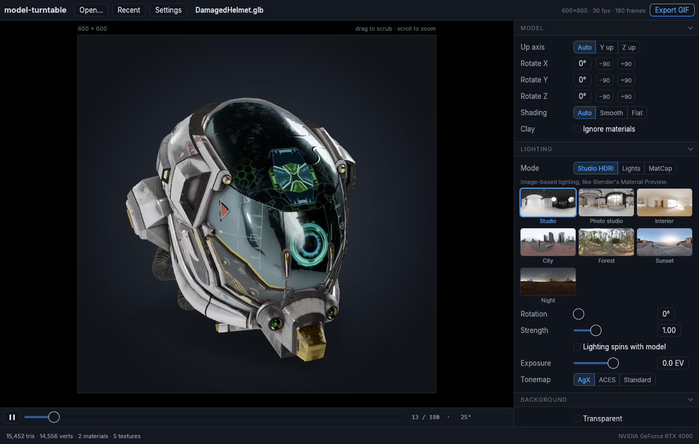
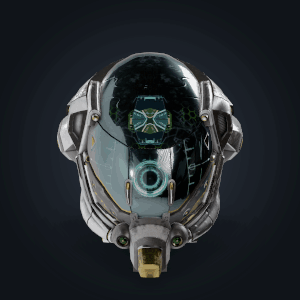

# model-turntable

Turntable GIFs and videos of 3D models. Drop in a model, pick a look, export.





- Opens glTF/GLB, FBX, OBJ and STL, textures included.
- Studio HDRI lighting in the style of Blender's Material Preview, with seven built-in environments. Also includes the classic light presets from turntable-stl and MatCaps.
- Exports GIF, MP4 (H.264), WebM (VP9, with alpha), ProRes 4444, DNxHR, animated WebP, APNG and PNG sequences.
- Any output size, square or not (600×600, 1920×1080, 1080×1920, ...).
- Loops seamlessly. Spin or swing, with optional easing, multiple turns and camera elevation.
- Supersampled anti-aliasing, a soft ground shadow, transparent backgrounds and AgX/ACES tonemapping.
- A CLI for batch rendering.

Replaces [turntable-stl](https://github.com/Sirsyorrz/Turntable-STL).

## Install

Download a release for your platform:

- **Windows:** unzip and run `model-turntable.exe`.
- **Linux:** `chmod +x` the `.AppImage` and run it. You can also use the tarball's bare binary.

GIF, WebP, APNG and PNG export are built in. The video formats need [ffmpeg](https://ffmpeg.org). If ffmpeg isn't on your `PATH`, the app offers to download a copy for you.

### From source

```
cargo build --release
./target/release/model-turntable [model]
```

On Linux the build needs `libxkbcommon` and `wayland` headers. At runtime it uses Vulkan, and on Windows it uses DX12 or Vulkan.

## Using it

Drag a model onto the window, or use **Open** (Ctrl+O). Then:

- Drag the preview to scrub through the loop.
- Scroll to zoom. Double-click resets the zoom.
- Space plays and pauses.

**Export** (Ctrl+E) asks where to save and renders in the background.

What you see in the preview is what gets exported. It uses the same renderer at a lower resolution.

Each lighting mode suits a different job:

- **Studio HDRI** gives realistic reflections. It's the best fit for textured and PBR models.
- **Lights** offers the directional presets from turntable-stl. These work well for untextured prints.
- **MatCap** has no lighting setup at all. The shading is baked into a sphere image, which makes it quick for clay previews.

By default the model spins under fixed lighting, so highlights travel across it. Tick **Lighting spins with model** to light it the same way on every frame.

**Settings > Save settings** writes your current setup to JSON. You can load that file in the GUI or pass it to the CLI.

## CLI

```
model-turntable render model.glb -o out.gif --size 600x600
model-turntable render part.stl -o spin.mp4 --size 1920x1080 --fps 60 --duration 8 --lighting lights --preset "Soft even (product shot)"
model-turntable render model.fbx -o alpha.webm --transparent --hdri city
model-turntable render model.glb -o frames/ --png-sequence --settings my-look.json
model-turntable list
```

The output format comes from the file extension: `.gif .mp4 .webm .mov` (ProRes, or DNxHR with `--dnxhr`), `.webp .png` (APNG). Run `model-turntable render --help` for every flag.

## Notes

- The model shows a static pose. Animations and skinning are ignored, so pose the model in Blender and export it if you want something else.
- glTF is the most reliable format. For FBX, embedded textures or textures next to the file are found automatically.
- STL files are assumed to be Z-up, which is the convention for 3D printing. Most other formats are Y-up. If a model comes out lying down, use **Up axis** or the rotate buttons.
- GIF alpha is on/off only. A transparent GIF blends its soft edges into the matte colour.
- Free DaVinci Resolve on Linux can't decode H.264. Use ProRes or DNxHR for footage you plan to edit there.

## Credits

- HDRIs from [Poly Haven](https://polyhaven.com) (CC0): studio_small_09, brown_photostudio_02, lebombo, potsdamer_platz, forest_slope, venice_sunset, dikhololo_night.
- [Inter](https://rsms.me/inter/) font (SIL OFL 1.1).
- The example model is [Damaged Helmet](https://github.com/KhronosGroup/glTF-Sample-Assets/tree/main/Models/DamagedHelmet) by theblueturtle_ (CC BY 4.0).

## License

MIT
